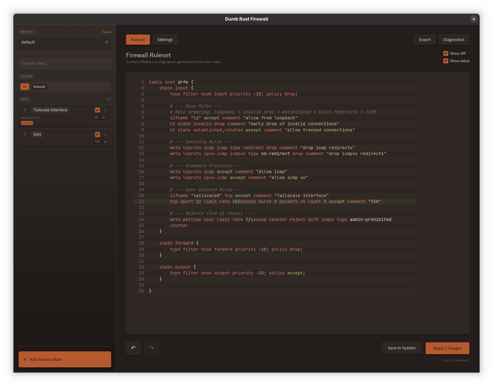

# DRFW — Dumb Rust Firewall

A safe, transparent nftables firewall for Linux, with a GUI and CLI.

<p align="center">
  <a href="https://github.com/ledati16/drfw/actions/workflows/ci.yml"></a>
  <a href="LICENSE"></a>
  <a href="https://www.rust-lang.org/"></a>
  <a href="Cargo.toml#L17-L44"></a>
  <a href="https://github.com/iced-rs/iced"></a>
  <a href="#appendix-llm-generated-code"></a>
</p>

## Philosophy

DRFW follows the "dumb firewall" principle: **explicit is better than implicit**. No magic, no auto-detection, no surprises. You control exactly what's allowed through your firewall.

- **GUI-first**: Simple, focused interface for managing firewall rules
- **JSON-first**: Applies through nftables' JSON API (no shell interpolation, no command injection risks); the boot file is rendered from the very same commands
- **Safety-first**: Pre-apply verification and a root-side dead-man switch that auto-reverts even if DRFW or your SSH session dies
- **Desktop-friendly**: Conservative defaults that work out-of-the-box for most users

## Screenshots

<p align="center">
  
</p>

## Features

### Core Functionality
- **Add/edit/delete firewall rules** via clean GUI
- **Protocol filtering**: TCP, UDP, TCP+UDP, ICMP (v4), ICMPv6, ICMP (both), or Any
- **Port matching**: Single port, range (`8000-8080`), or multiple (`22, 80, 443, 8000-8080`)
- **Source/Destination IP filtering**: Allow traffic from/to specific networks (CIDR notation, multiple IPs per rule)
- **Interface filtering**: Exact match (`eth0`) or wildcards (`docker*`, `veth*`)
- **Rule reordering**: Drag-and-drop to change rule priority
- **Enable/disable toggles**: Disable rules without deleting them
- **Tag-based organization**: Add multiple tags per rule, filter by tag
- **Search**: Real-time fuzzy search across all rule fields

### Advanced Rule Options
- **Action types**: Accept, Drop, or Reject (with type: port-unreachable, host-unreachable, admin-prohibited, tcp-reset)
- **Rate limiting**: Per-rule rate limits with optional burst (e.g., `5/minute burst 10`)
- **Connection limiting**: Max simultaneous connections per rule
- **Per-source limits** (Accept rules only): Optionally give every client IP (IPv6: every /64) its own rate or connection budget, so one client that uses up its budget does not use up everyone else's. Up to 65535 clients are tracked per rule; a flood from more distinct (e.g. spoofed) addresses than that blocks *new* clients until it stops, while known clients keep their budgets. Not offered for Drop/Reject rules: there a full table would let new sources through
- **Per-rule logging**: Toggle to log matched packets with auto-generated prefix
- **Chain selection**: Input, Output (in Server Mode) or "Forwarded (routed through)" for traffic routed through this computer (with **Block forwarded traffic** on). An inactive Output or Forwarded rule can be moved to Input and back while you edit it
- **Output interface**: Filter by the interface traffic leaves on (Output rules in Server Mode, Forwarded rules)
- **Rule templates**: "Add from template" (the ▾ next to **Add Access Rule**) offers ready rules for the network interfaces this computer has: DHCP and DNS for VM guests on a libvirt bridge (`virbr*`), and for Tailscale (`tailscale0`) "Tailscale: direct connections" (UDP 41641) and "Trust tailscale0". They become ordinary rules you can edit or delete, and Ctrl+Z removes them again. A template whose rules are all in the profile already shows "Already in this profile." and cannot be added twice. The VM-guest template notes what else such a setup needs: in Server Mode, an Output rule for the DHCP offers (UDP to port 68 on the bridge), and with **Block forwarded traffic** on, Forwarded rules for guest traffic routed through this computer

### Safety Features
- **Rule validation**: Every rule is checked by one validator (ports, ranges, address families, interfaces, limits, ...). Invalid rules are kept in the profile and marked INVALID, but nothing is applied or saved while an applied rule is invalid
- **Pre-apply verification**: `nft --check` validates the generated ruleset before applying (unprivileged, in a private namespace, when possible)
- **Dead-man switch**: Configurable countdown (5-120s, on by default) with auto-revert if not confirmed. The revert is armed as root when the rules are applied, so it still happens if DRFW is closed or crashes, or the terminal/SSH session is lost, and it needs no second password prompt
- **Exact rollback**: The previous `inet drfw` table is restored exactly (or removed, if there was none)
- **Manual revert**: One-click rollback during the countdown
- **One generator**: Apply (JSON), the preview, `drfw export` and Save to System (text) all render the same command list, so what you see is what is applied and what boots
- **No silent data loss**: A damaged or newer-version profile/config is copied aside and opened read-only, never overwritten
- **Undo/Redo**: Full history for all rule modifications (Ctrl+Z / Ctrl+Shift+Z)
- **SSH lockout check**: Before Apply and Save to System, DRFW checks whether the new rules would keep the client of a current SSH session from reconnecting, and asks for an explicit confirmation if so; a rate- or connection-limited SSH rule is only noted (see [SSH lockout check](#ssh-lockout-check))

See [Safety Model](#safety-model) for how Apply, Confirm and the revert guard work.

### Default Protection (Always On)
DRFW is a **stateful firewall** with sensible defaults that require no configuration:

| Rule | Purpose |
|------|---------|
| Allow loopback | Local services always work (`127.0.0.1`) |
| Drop invalid packets | Malformed and out-of-state packets are dropped early |
| Block ICMP redirects | Nobody on the network can re-route your connections. Checked before "established/related", so a redirect that quotes an open connection is dropped too |
| Limit incoming pings *(setting: ICMP rate limiting)* | Ping requests over N per second are dropped (IPv4 and IPv6 each) |
| Allow established/related | Return traffic for your connections works automatically |
| Drop loopback addresses from the network | Packets from or to `127.0.0.0/8` that arrive on anything but `lo` are dropped |
| Anti-spoofing *(setting: RPF)* | New packets whose source address could not have arrived on that interface are dropped |
| Allow DHCP and DHCPv6 replies | IPv4 and IPv6 address configuration and renewal keep working |
| *(your rules)* | In the order you give them |
| Allow IGMP | Multicast group membership keeps working (IPTV, UPnP/SSDP on switches with IGMP snooping) |
| Allow local discovery *(setting, Desktop mode)* | mDNS, SSDP/UPnP and WS-Discovery, and the replies to this computer's own discovery queries (output rules remember the ports those queries leave from): printers, TVs and speakers can find it, and it can find them. On for profiles the GUI creates; see **Local network discovery** below |
| Allow ICMP | Ping and network diagnostics work |
| Default deny | Everything else is refused: unicast packets get a rate-limited "administratively prohibited" reply (5/s, comment "rate-limited reject"), then everything left is counted ("final counter") and dropped (INPUT chain policy) |

That is also the order in which they are checked. Your rules come before "Allow IGMP",
local discovery and "Allow ICMP", so a Drop or Reject rule (say, "drop everything from
203.0.113.7") also stops that host's pings. They come after "Allow established/related", as in any stateful firewall:
a Drop rule stops **new** connections; connections that are already open (and ICMP
errors that belong to them) keep working until they close. The ping limit comes before
your rules, so no rule can exempt a source from it. "Log dropped packets" logs, rate
limited, what reaches the end of the chain, unicast only (broadcast and multicast noise
is not logged).

A Drop/Reject rule with both a rate limit and a connection limit drops what is over
either limit (it becomes two rules in the preview, one per limit).

Forwarded (routed) traffic is accepted by default so Docker, libvirt and VPN
routing keep working; see **Block forwarded traffic** below. DRFW does not filter it
then: when IP forwarding is on, `drfw status`, the Exposure view and the "Commit
Changes?" dialog say "This computer forwards traffic between its networks (IP
forwarding is on). DRFW does not filter forwarded traffic; containers, VMs or other
networks may be reachable through it." Ports Docker publishes travel that way too
(DNAT, then the forward chain), past every input rule. Exposure and `drfw exposure`
mark their sockets instead of giving a verdict: with **Block forwarded traffic** off,
"Published by Docker: not filtered by DRFW's rules"; with it on, "Published by Docker:
decided by your Forwarded rules (blocked unless one allows it)", because DRFW's forward
chain then drops what no Forwarded rule accepts. A `docker-proxy` only counts when it
runs as root (real and effective user id 0) and the socket is root's, so a program
merely named `docker-proxy` cannot hide a port. When Docker or Podman networks exist
but no `docker-proxy` is found, a notice says that their published ports "are not
filtered by DRFW's rules and may not be listed here" (with **Block forwarded traffic**
on: "are decided by your Forwarded rules (blocked unless one allows them) and may not
be listed here").

These base rules are **not configurable** — they represent security best practices that 99%+ of users need. Without stateful filtering, you'd need explicit rules for every connection's return traffic.

### Local network discovery

"Local network discovery" (Settings → Network) lets this computer find and be found by
printers, TVs, speakers and other computers on your network. It accepts:

- mDNS multicast (224.0.0.251 / ff02::fb, UDP 5353) and SSDP/UPnP and WS-Discovery
  multicast (239.255.255.250 / ff02::c / ff05::c, UDP 1900 and 3702);
- for 10 seconds, unicast replies to a UDP port this computer just sent a genuine
  discovery query from, only from private and link-local addresses (10.0.0.0/8,
  172.16.0.0/12, 192.168.0.0/16, 169.254.0.0/16, fe80::/10, fc00::/7). Genuine queries
  are SSDP or WS-Discovery to 239.255.255.250 / ff02::c / ff05::c on port 1900 or 3702,
  mDNS to 224.0.0.251 / ff02::fb on 5353, LLMNR to 224.0.0.252 / ff02::1:3 on 5355, and
  NetBIOS name queries broadcast to port 137. Other broadcast or multicast traffic (a
  game's LAN announcement, say) never opens the port it was sent from. NetBIOS datagrams
  (port 138, e.g. the old Windows network browser) are not supported.

Profiles the GUI
creates (the first one, "New empty profile", "Start fresh") have it on; profiles that
existed before keep it off, and the GUI asks once (one notice for all profiles, about
the profile open at the time): "Printers, TVs and other devices can't find this
computer, and it can't find them. [Turn on local network discovery] [Not now]". It is a
Desktop mode setting (Server Mode ignores it). Turn it off on networks you don't trust:
every device on the link can then reach the mDNS responder.

### Advanced Security Settings
All disabled by default for maximum compatibility:

| Setting | Purpose | Warning |
|---------|---------|---------|
| **Strict ICMP** | Allow only the ICMP types networks need: ping, error reports, MTU discovery, IPv6 neighbor and router discovery, and multicast listener (MLD) messages | Ping, traceroute and MTU discovery keep working. Only rarely used types are blocked, such as timestamp and address-mask requests and other exotic ICMP |
| **ICMP Rate Limiting** | Limit incoming ping requests to N per second | Ping requests over the limit are dropped, per IP family, even within a running ping; fast monitoring pings may see loss. Checked before your rules, so a rule cannot exempt a source. Other ICMP (errors, IPv6 neighbor discovery) is never limited |
| **Anti-spoofing (RPF)** | Drop new connections whose source address could not have arrived on that interface. Useful with rules that trust a source address | May block peers that contact a full-tunnel VPN first. Docker and libvirt bridges, split-tunnel VPNs and full-tunnel VPN clients (wg-quick, a Tailscale exit node) keep working |
| **Dropped Packet Logging** | Log filtered traffic to syslog | Can fill logs quickly |
| **Server Mode** | Block outgoing connections unless a rule allows them | For locked-down servers; you must allow DNS, time sync and updates yourself (offered when you switch it on) |
| **Block forwarded traffic** | Forward chain policy drop (established/related still accepted); forwarded traffic then needs Forwarded rules | **Docker, libvirt and VPN routing stop** until Forwarded rules allow them; for routers that want default-deny forwarding |

### Desktop vs Server Mode

| | Desktop (default) | Server |
|---|---|---|
| Incoming | Default deny + your rules | Default deny + your rules |
| Outgoing | Everything allowed | Default deny + your OUTPUT rules |
| Always allowed outgoing | - | Loopback, replies to accepted connections, IPv6 neighbor discovery, IGMP and MLD multicast membership reports, DHCP/DHCPv6 client requests |
| Rule chain choice | Input (and Forwarded with **Block forwarded traffic**) | Input or Output (and Forwarded with **Block forwarded traffic**) |

Server Mode keeps loopback, established connections and address renewal (DHCP)
working, so switching it on does not cut off an SSH session or lose the lease. It does
not allow anything else: without rules the computer can't look up names, set its clock
or download updates. When you switch it on, the GUI offers these as ordinary Output
rules, pre-ticked: DNS (TCP+UDP 53), DNS over TLS (TCP 853), time sync (NTP, UDP 123),
web and updates (TCP 80, 443) and ping. A rule you already have counts only while it
is enabled: a disabled "DNS" rule does not, so DNS is offered (ticked) again. With
rules ticked, turning Server Mode on and adding them is **one** undo step: Ctrl+Z turns
Server Mode off again and removes those rules, and redo brings both back. With nothing
ticked only the setting changes (settings are not in the undo history). If the ticked
rules would not fit under the rule limit, Server Mode is not turned on. The added rules
can be edited or deleted like any other rule.
OUTPUT rules in a profile are ignored (and not validated as applied) in Desktop
mode.

### User Experience
- **27 color themes**: Oxide, Dracula, Tokyo Night, Catppuccin, Nord, Gruvbox, Monochrome, and more
- **Accessibility options**: Monochrome theme and reduced syntax colors mode (2-level highlighting)
- **Custom fonts**: Select UI and monospace fonts from system fonts
- **Live preview**: Syntax-highlighted nftables output
- **Diff view**: See exactly what changes before applying
- **In-app notifications**: Success, warning, and error banners
- **Diagnostics viewer**: Built-in event log browser with filter and search, times in local time (with the date for older events)
- **Exposure view**: Lists the programs listening for connections on this computer (TCP and UDP, IPv4 and IPv6) and, for each, who can reach it through your rules: everyone, specific source networks, nobody, or local only (bound to loopback); with local network discovery on, UDP sockets on the discovery ports (5353, 1900, 3702, 5355, 137) read "local network (discovery)", or "local network, for 10 s after it sends a discovery query" when only the replies to its own queries reach it; neither is counted as exposure, and other ports are not shown as reachable through discovery. Sockets open to everyone are flagged (in red; those open to everyone on some interfaces only, such as a VPN, in amber), rate- or interface-limited access is spelled out, and the deciding rule opens in the editor with one click. It compares the rules in the editor with the ones DRFW applied, so you can see what a change would expose before applying it. The socket list is read without privileges; process names are shown only for your own processes, because naming the processes behind other users' (e.g. system services') sockets needs root, which DRFW deliberately does not use for this. Sockets that are the host side of a port Docker publishes (a `docker-proxy` running as root, on a root-owned socket) are marked PUBLISHED BY DOCKER instead of a verdict: "not filtered by DRFW's rules", or, with **Block forwarded traffic** on, "decided by your Forwarded rules (blocked unless one allows it)". Notices say when IP forwarding is on and not blocked, or when Docker or Podman networks exist without a `docker-proxy` to show their ports. It also says, for each current SSH session, whether its client could open a new connection under the editor's rules (see [SSH lockout check](#ssh-lockout-check)). `drfw exposure` prints the same from the command line
- **Keyboard shortcuts**: Ctrl+N (new rule), Ctrl+S (apply), Ctrl+E (export), F1 (help)

### Profile Management
- **Multiple profiles**: Save different rule configurations
- **Quick switching**: Change profiles with unsaved-changes detection
- **Import/Export**: Export as nftables text or JSON

### CLI Interface
Full command-line support for scripting and automation:

```bash
drfw              # Launch GUI
drfw --help       # Show all commands
drfw list         # List all profiles
drfw status       # Active profile, rule/invalid counts, mode, forwarding, SSH sessions, pending auto-revert, boot config + service, kernel
drfw check <profile>                 # Validate + nft --check without privileges; changes nothing
drfw apply <profile>                 # Apply with 15s auto-revert safety
drfw apply <profile> --confirm 30    # Apply with 30s timeout (5-120)
drfw apply <profile> --no-confirm    # Apply without auto-revert (until reboot)
drfw apply <profile> --yes           # ... even if the retention guard or the SSH lockout check warns
drfw save <profile>                  # Save to System: the boot config (one prompt)
drfw save <profile> --enable-at-boot # ... and enable the boot service if needed
drfw export <profile> --format nft   # Export as nftables text (default)
drfw export <profile> --format json  # Export as nftables JSON
drfw exposure [profile]              # Who can reach the listening services (default: active profile)
drfw exposure [profile] --json       # ... as JSON, for scripts
```

- `drfw check` exits with 0 when the profile can be applied and 1 otherwise. It
  never asks for a password: the nft check runs in a private user + network
  namespace (`unshare -rn`).
- `drfw status` only reports what an unprivileged user can read: the profile, whether
  an apply is still waiting for confirmation (`/run/drfw`), whether
  `/etc/nftables.conf` was written by DRFW, and whether a systemd unit loads it at
  boot ("Boot persistence", from `systemctl is-enabled`). It does **not** read the live
  kernel ruleset (that needs root); run `sudo nft list table inet drfw` for that.
- `drfw apply` changes the running ruleset only. Use `drfw save` (or **Save to System**
  in the GUI) to make rules survive a reboot.
- `drfw save` writes the same file as the GUI's Save to System. The saved rules load at
  the next boot **without** a dead-man switch, so if the profile is not exactly what you
  last applied *and kept* on this machine (see [The kept-ruleset
  record](#the-kept-ruleset-record)), it warns and asks (or, without a terminal,
  refuses unless you pass `--yes`). The safe sequence on a server is `drfw apply web`,
  confirm, `drfw save web`. It warns when the boot service is not enabled;
  `--enable-at-boot` enables it in the same prompt.
- `drfw apply` and `drfw save` ask before a big change (see [Retention
  guard](#retention-guard)) and before rules that would lock out a current SSH session's
  client (see [SSH lockout check](#ssh-lockout-check)); without a terminal they need
  `--yes`. A rate- or connection-limited SSH rule is only noted, without a question.
- `drfw status` also has a "Forwarding" line: "IP forwarding is off", the forwarding
  notice above when the kernel forwards and the profile does not block forwarded
  traffic, or that the profile blocks it.
- `drfw status` also has an "SSH" line per SSH session: "you are connected from X to port
  22; new connections from X would be accepted by rule "SSH"" (or BLOCKED, and by what),
  under the rules of the active profile ("no SSH session into this computer found"
  without one). Its last line, "Kernel", says that the live ruleset was not checked
  (listing it needs root) and how to inspect it.
- `drfw exposure` prints the Exposure view as a table: socket (protocol, port, family),
  process, bind address, who can reach it, and the deciding rule. Sockets every address
  can reach are marked `OPEN TO EVERYONE` (in red on a terminal; plain text when piped);
  those every address can reach only through some interfaces (for example a rule for
  `tailscale0`: everyone on the tailnet, not the internet) are marked
  `OPEN ON tailscale0` (in yellow) and listed after them. With local network discovery
  on, UDP sockets on the discovery ports (5353, 1900, 3702, 5355, 137) read "local
  network (discovery)" when the discovery multicast reaches them, or "local network,
  for 10 s after it sends a discovery query" when only the replies to their own queries
  do (port 5355 and 137, or a socket bound to a unicast address). Neither is counted as
  exposure. Other ports are not shown as reachable through discovery: they only get
  replies, for 10 seconds, after sending a genuine query themselves, like the replies
  to an outgoing connection. Ports Docker publishes read "published by Docker: not
  filtered by DRFW's rules", or, with **Block forwarded traffic** on, "published by
  Docker: decided by your Forwarded rules (blocked unless one allows it)" (JSON:
  `published_by_docker`, `docker_forward_filtered`).
  The SSH lines of `drfw status` follow. `--json` prints an object with `profile`,
  `sockets` (one object per socket: `transport`, `port`, `families`, `bind`,
  `bind_display`, `local_only`, `uid`, `process`, `processes`, `reachable_from`,
  `open_to_everyone` (every address, on any interface), `scope` = `any`/`interfaces`/null
  (where every address can connect from), `interfaces` (for `scope` = `interfaces`),
  `nobody`, `published_by_docker`, `docker_forward_filtered` (with `published_by_docker`:
  the Forwarded rules decide it), `local_discovery` (reached through local network
  discovery), `decided_by`, `decided_by_rule_id`), `forwarding`
  (`ipv4`, `ipv6`, `filtered`: false when forwarded traffic passes unfiltered), `notes`
  (the forwarding and container-network notices that apply) and `ssh_sessions`
  (`client`, `client_port`, `server`, `server_port`, `source`, `interface` (the one that
  owns `server`, or null), `new_connections` = `accepted`/`limited`/`may_be_blocked`/
  `blocked`, `outcome`). It evaluates the profile's rules,
  not the kernel's (listing those needs root).
- During the `drfw apply` countdown, if another apply replaces the pending one, the
  countdown stops at once and reports it.

Exit codes (also in `drfw --help`):

| Code | Meaning |
|------|---------|
| 0 | Success: applied and kept (confirmed, or `--no-confirm`), reverted (on timeout or on request), saved |
| 1 | Failed, nothing was changed (or `drfw check` found problems) |
| 2 | Usage error |
| 3 | `apply`: the previous rules could not be restored, so the drfw table was **removed**: drfw is not filtering anything |
| 4 | `apply`: the revert **failed**: the new, unconfirmed rules are still active |
| 5 | `apply`: another apply replaced these rules before they were confirmed |
| 6 | `apply`: the outcome is **unknown**: the new rules may be active (e.g. the apply was interrupted after authentication) |
| 7 | `save`: not saved, the rules are not the ones last applied and kept (confirmed, or applied with `--no-confirm`) with `drfw apply` or the GUI (use `--yes`) |
| 8 | `save`: saved, but the boot service could not be enabled |
| 9 | `apply`/`save`: not done, the retention guard or the SSH lockout check asks for a confirmation (use `--yes`) |

A timed-out revert exits 0: that is the dead-man switch doing its job. Codes 3 to 6 mean
"look at the firewall now"; scripts must not treat them like 1.

- Run `drfw` as your user, not with `sudo`: it asks for elevation itself, and under
  `sudo` it would look for profiles in root's home.
- `--confirm` takes 5 to 120 seconds; other values are refused (exit 2).
- During the countdown, `c` or Enter keeps the rules and `r`, Esc or Ctrl-C revert them. Keys
  typed before the countdown starts (for example an extra Enter while the password
  prompt was open) are discarded, so they cannot confirm it.
- Output into a closed pipe (`drfw status | head -1`) ends `drfw` quietly instead of
  panicking (it used to exit with 101).
- `drfw save` says how the ruleset was kept: "This exact ruleset was applied and kept
  (confirmed) on this machine", or "applied and kept (without auto-revert)" after an
  apply with auto-revert off or `--no-confirm`.

**Choosing the elevation tool.** In a terminal the CLI elevates with `run0` if it is
installed, else `sudo`; without a terminal, and always in the GUI, with `pkexec`.
The environment variable `DRFW_ELEVATION_METHOD=sudo` (or `run0`, `pkexec`) overrides
that choice, e.g. to use `sudo` where `run0` is installed but not usable, such as in
some SSH sessions. It only changes which tool asks for the password; there is
deliberately no password-less mode (the elevated program is `/bin/sh` with a fixed
script, so a `NOPASSWD` rule for it would grant unrestricted root). An unknown value or
a tool that is not installed is an error. Automation that already runs as root can run
`drfw` as root: it then elevates nothing.

## Installation

### Prerequisites

**Required at runtime:**
- Linux with nftables support, and the `nftables` package (`nft`)
- Privilege escalation: `run0` (systemd v256+), `sudo`, or `pkexec` (the GUI uses `pkexec`)
- systemd is optional: without it the revert guard runs as a detached process, and
  DRFW cannot tell whether the rules load at boot
- `unshare` (util-linux) and unprivileged user namespaces for the password-free
  `nft --check`: `drfw check` needs them; before Apply, DRFW falls back to an elevated
  check (one more prompt) without them

**Kernel and nftables versions.** The generated ruleset uses dynamic sets updated from
the packet path (`update @set`/`add @set` for per-source limits and local discovery,
including per-source `ct count`), `fib` lookups with the packet mark (anti-spoofing) and
the nftables JSON API. These need a reasonably recent kernel and nftables. DRFW is
tested against the real `nft` on Ubuntu 24.04 (nftables 1.0.9, in CI) and on Arch
Linux (nftables 1.1.x, current kernels); older combinations are untested. To find out
whether this machine supports a profile, run `drfw check <profile>`: it hands the
ruleset to this kernel's `nft --check` without changing anything.

**Required to build:**
- Rust 1.100 (2024 edition; pinned in `rust-toolchain.toml`) — Install via [rustup](https://rustup.rs)

**Check nftables:**
```bash
nft --version
```

**Install nftables:**
```bash
# Arch Linux
sudo pacman -S nftables

# Debian/Ubuntu
sudo apt install nftables

# Fedora
sudo dnf install nftables

# openSUSE
sudo zypper install nftables
```

### Building from Source

```bash
git clone https://github.com/ledati16/drfw.git
cd drfw
cargo build --release
./target/release/drfw
```

### System-wide Installation

```bash
sudo cp target/release/drfw /usr/local/bin/
drfw
```

## Usage

### Basic Workflow

1. **Launch DRFW**: `drfw`
2. **Add a rule**: Click **Add Access Rule**, configure protocol/port/source/interface
3. **Preview**: View syntax-highlighted nftables output in the preview pane
4. **Apply**: Click **Apply Changes** — DRFW verifies, then applies with one elevation prompt
5. **Confirm**: Click **Confirm & Stay** (or press Ctrl+Enter) within the countdown, or rules auto-revert
6. **Persist** (optional): **Save to System** (or `drfw save`) writes the rules to `/etc/nftables.conf` for boot

## Safety Model

**One prompt per apply.** Apply runs one fixed, elevated script that saves the
current `inet drfw` table (or notes that there is none) as a revert batch in
root-owned `/run/drfw` (mode 755; the revert batch, the watcher script and the lock are
0600, readable only by root; only `active` and the `status-*` files are 0644, for
`drfw status`), starts a detached root watcher
and only then applies the new ruleset. Nothing else needs a password (DRFW ships no
polkit rule that would cache an authorization):

| Step | Prompt | What happens |
|------|--------|--------------|
| Verify | none (normally) | `nft --check` in a private namespace; only if that is inconclusive is the elevated check used |
| Apply | **one** | Save current table, apply, arm the revert guard |
| Confirm | none | DRFW creates a token file in your runtime directory; the watcher sees it |
| Revert now / timeout | none | The watcher restores the saved table |

**Works over SSH.** The watcher runs as root on its own (a `drfw-revert-*`
systemd unit, or a `setsid` process without systemd) and times out on the
monotonic clock. If you lock yourself out, the terminal closes, the SSH
connection drops or DRFW crashes, the previous rules come back on time. In a
terminal DRFW elevates with `run0` or `sudo`, so `drfw apply` works over SSH;
the GUI always uses `pkexec` (a graphical dialog), even when started from a terminal
(see [Choosing the elevation tool](#cli-interface) to override it).

**No unguarded window.** The elevated script ignores hang-up, interrupt and terminate
signals, so an SSH drop or Ctrl-C right after the password cannot stop it halfway, and
the watcher exists before the new rules go live, so even a killed script leaves them
guarded. If DRFW cannot tell what happened after you authenticated (the script was
killed, or took more than 90 seconds), it says the state is **unknown** and that the
new rules may be active, instead of "nothing was changed"; a guarded apply then still
reverts when its countdown ends. In the GUI the banner stays short and opens **Apply
Details** with the full explanation (reopen it from the header button). Such banners
("New rules MAY BE ACTIVE…", "Revert FAILED…") stay until you close them; later
banners do not push them out. The panel stays across a profile switch: it describes the
kernel, not the profile.

**Who can confirm.** Confirm and revert tokens are files in your `$XDG_RUNTIME_DIR`
(or DRFW's state directory), which must belong to you and be closed to other users
(mode 0700); the watcher only counts tokens owned by you. The guard's id is not a
secret (other local users can see it), so ownership is what protects it.

**Stopping the guard reverts.** A revert guard stopped by SIGTERM, SIGHUP or SIGINT
(`systemctl stop`, `kill`, a shutdown) reverts at once instead of leaving unconfirmed
rules behind. Only SIGKILL can end it without a revert; `drfw status` then reports
"LOST since …: the last apply was never confirmed, but its revert guard ended without
reverting; its rules stay active" instead of PENDING.

**Fail-safe revert.** If the saved table cannot be restored, the watcher removes the
`inet drfw` table instead (DRFW then filters nothing) rather than leave a locked-down
ruleset in place. Only if even that fails are the new rules reported as still active.

A new apply during a pending countdown replaces the earlier guard and keeps its
revert point: a timeout always goes back to the last *kept* rules.

### The kept-ruleset record

When you keep an apply (confirm it in time, or apply with auto-revert off, in the GUI or
with `drfw apply --no-confirm`), DRFW records it in
`~/.local/state/drfw/confirmed-ruleset.json` (mode 0600, written atomically): the exact
nftables JSON that was applied, the rules it came from, and the boot id. The GUI loads it
at startup and the CLI reads it, so both agree on what was last applied and kept.
Reverted, superseded or failed applies never change it. A profile counts as *tested*
when its nftables JSON is byte for byte the recorded one.

The record says what was **applied**, not what is running now: a reboot without Save to
System, `nft flush ruleset` or another tool can change the kernel's rules. When the
record is from an earlier boot (or from an older DRFW that did not store the boot id),
the Save to System dialog and `drfw save` say that it was kept in an earlier session and
may not be what is running.

Until the GUI applies something itself, its diff and the Exposure view compare the
editor with the record, and say so: "Show diff (vs last applied)" for a record from this
boot, "Show diff (vs last kept, earlier session)" for an older one (and "vs last kept"
after an apply of this session that was not kept). The Apply button still shows
unapplied changes (`Apply Changes*`) until the GUI has applied the rules, since the
record cannot tell what the kernel runs now.

`--no-confirm` counts as kept on purpose: it is the same explicit choice as turning
auto-revert off in the GUI, and a record left at an older ruleset would describe rules
that are no longer in place (and would make the retention guard compare against them).

### Retention guard

Before **Apply** and **Save to System** (GUI, `drfw apply`, `drfw save`), DRFW compares
the ruleset with the last one applied and kept, and asks for an explicit confirmation
when it:

- removes or changes at least 3 of the enabled rules, and at least 40 % of them (rules
  are matched by id; disabling a rule counts as removing it, and so does editing a kept
  rule to act on other traffic or differently: Accept turned into Drop, sources
  narrowed, moved to another chain, …). The warning reads "Removes N of the M enabled
  rules last applied and kept (deleted or disabled)", or "Removes or changes N of the M
  …" when edited rules count;
- switches from Desktop to Server Mode (outgoing connections need allow rules);
- turns on **Block forwarded traffic**.

The GUI lists the removed rules (the first 10, then "+N more") in the "Commit
Changes?" or Save to System dialog; applying then takes a click on **Apply anyway**
(Enter does not do it), and saving the editor's rules a click on a red button. The CLI
prints the same lines and asks y/N on a terminal; without one it needs `--yes` (exit
code 9 otherwise, nothing changed). With no record yet, only the two mode changes ask.

### SSH lockout check

Open SSH sessions survive any apply: established connections are accepted before any
of your rules (and before the output rules in Server Mode, so Server Mode cannot cut a
session's replies either). The risk is the **next** connection. Before **Apply** and
**Save to System** (GUI, `drfw apply`, `drfw save`) DRFW finds the current SSH sessions
into this computer without privileges and asks the rules about to be used what they do
with a new connection from each session's client address to the session's port:

- the session DRFW runs in, from `SSH_CONNECTION`;
- other sessions, from the established TCP connections in `/proc/net/tcp{,6}`: those
  held by a process named `sshd*`/`dropbear` (your own sessions are found this way), and
  those to port 22 (or to a port a readable `sshd` listens on) whose process belongs to
  another user. Other users' sessions on a non-standard port whose server is not
  readable are not found.

If a new connection would be dropped or rejected, or may be in a case the check cannot
settle (an interface it does not know, see below), the "Commit Changes?" (or Save to
System) dialog shows why and takes a click on **Apply anyway** (or the red save button);
the CLI prints the same lines and asks y/N on a terminal, or needs `--yes` (exit code 9,
nothing changed).

A connection accepted only up to a **rate or connection limit** (e.g. "SSH up to
3/minute per source", the recommended setup) is a **note**, not a warning: the dialog
shows "New SSH connections are limited by these rules" in the info style and applies
with the normal button (Enter works); the CLI prints it and goes ahead (no question, no
exit 9). Asking every time for a limit that is there on purpose would only teach you to
click through the real warnings.

The session's interface is the one that owns the address the client connected to (the
local address of the session). Packets for an address normally arrive on the interface
that has it, so a rule that allows SSH only on `eth0` is checked against that interface:
allowed if the session's address is on `eth0`, blocked if it is on another one. With
asymmetric routing they can arrive elsewhere, so whenever the interface decided the
answer it says so ("assuming they arrive on eth0, the interface that has 10.0.0.1"). When
no interface, several interfaces or the loopback interface have that address, the
interface stays unknown and an interface-bound SSH rule counts as "blocked in some
cases". The check assumes the client passes the reverse-path check when anti-spoofing
(RPF) is on, as the open session from it suggests. The Exposure view and `drfw status`
show the same per-session answer.

Both checks use fresh facts: when the "Commit Changes?" or Save to System dialog opens,
DRFW re-reads the SSH sessions and the kept-ruleset record (so a `drfw apply` made in a
terminal meanwhile counts). Until that is done the dialog says "Checking SSH sessions
and the kept rules…", its continue buttons are disabled and Enter does nothing. Both
dialogs scroll on small windows, so their buttons stay reachable.

## Save to System

**Save to System** makes the rules load at boot. Before you confirm, the dialog shows
whether the boot service (`nftables.service` by default) is enabled, asked without
privileges (`systemctl is-enabled`). If it is disabled, an **Also enable
nftables.service at boot** checkbox is offered, checked by default. Saving runs one
fixed, elevated script (one prompt) that:

1. writes the new file next to the target, then runs `nft -c -f` on **exactly those
   bytes** — a file nft rejects never replaces the current one;
2. copies the current file to `/etc/nftables.conf.drfw-bak` (the previous save);
3. the first time only, copies it to `/etc/nftables.conf.drfw-orig`, which is never
   overwritten, so your distribution's or hand-written config can always be recovered;
4. flushes the new file to disk and renames it into place atomically;
5. if the checkbox is checked, runs `systemctl enable nftables.service` (never `start`:
   that would reload the rules in the middle of your session). If enabling fails, the
   file is still saved and you get a warning.

Saved rules load at boot without a dead-man switch, so the dialog compares the editor
with the last rules applied and kept (see [The kept-ruleset
record](#the-kept-ruleset-record)). If they are the same, **Save** saves them. If they
differ, it offers **Save the last kept rules** (the main button) and a red **Save
untested rules** (the editor's rules); a retention warning then says which of the two
it is about ("Save untested rules" … is a big change). **Save the last kept rules**
writes the text of exactly the recorded nftables JSON (not the rules generated again,
which a newer DRFW might do differently). With nothing kept yet, only
**Save untested rules** is offered, with a warning.

Afterwards a banner says what was saved ("Configuration saved to …", or "Last kept
rules saved to …") and either "Loaded at boot by nftables.service" or that the rules
will **not** load at boot (service disabled, masked or missing).

The file starts with `table inet drfw` / `delete table inet drfw`, so loading it
(`nft -f /etc/nftables.conf`, `systemctl reload`) replaces only DRFW's table and never
duplicates rules. Enable `nftables.service` or the bundled `drfw.service` to load it at
boot (see [contrib/README.md](contrib/README.md)); DRFW counts either one as loading it.
`drfw status` tells you whether the current `/etc/nftables.conf` was written by DRFW
and whether it is loaded at boot.

To go back to the original config:

```bash
sudo cp -p /etc/nftables.conf.drfw-orig /etc/nftables.conf
```

### From the Command Line

`drfw save <profile>` does the same on a headless machine (one prompt). Because saved
rules load at boot without a dead-man switch, it warns loudly and asks (or needs
`--yes` without a terminal) unless the profile is exactly what you last applied and
kept (see [The kept-ruleset record](#the-kept-ruleset-record)); the [retention
guard](#retention-guard) applies too. It warns when the boot service is not enabled;
`--enable-at-boot` enables it in the same prompt. See the exit codes under [CLI
Interface](#cli-interface).

### Example Rules

**Allow SSH:**
- Protocol: TCP, Port: `22`

**Allow web server (HTTP + HTTPS in one rule):**
- Protocol: TCP, Port: `80, 443`

**Allow Minecraft from LAN only:**
- Protocol: TCP, Port: `25565`, Source: `192.168.1.0/24`

**Allow all Tailscale VPN traffic:**
- Protocol: Any, Interface: `tailscale0` (the template "Trust tailscale0")

**Allow all Docker container traffic:**
- Protocol: Any, Interface: `docker*` (wildcard)

**Rate-limited SSH with burst (prevent brute force):**
- Protocol: TCP, Port: `22`, Rate Limit: `3/minute burst 5`, Per source address: on

**Block port scanners with admin-prohibited:**
- Protocol: TCP, Port: `23`, Action: Reject (admin-prohibited)

### NetworkManager Integration

DRFW's CLI makes automatic profile switching trivial. Create a dispatcher script:

```bash
# /etc/NetworkManager/dispatcher.d/99-drfw
#!/bin/bash
case "$2" in
    up)
        case "$1" in
            wlan0) /usr/local/bin/drfw apply public --no-confirm --yes ;;
            eth0)  /usr/local/bin/drfw apply home --no-confirm --yes ;;
        esac
        ;;
esac
```

```bash
sudo chmod +x /etc/NetworkManager/dispatcher.d/99-drfw
```

Dispatcher scripts run as root, so `drfw` reads root's profiles
(`/root/.local/share/drfw/profiles/`): copy the profiles there. `--no-confirm` is needed
because nobody is there to confirm. `--yes` is needed because nobody is there to answer
either: switching between two different profiles usually removes most of the rules
last applied and kept, so the [retention guard](#retention-guard) asks, and without a
terminal `drfw` then refuses (exit code 9, nothing changed). The same happens when a
profile turns on Server Mode or **Block forwarded traffic**, or would block a current
SSH session's reconnect. Test each profile by hand (`drfw apply <profile>`, confirm)
before you let the script apply it unattended.

### VPN Compatibility

DRFW creates its own nftables table (`drfw`) at **priority -10**, evaluated before other
applications' tables, which it leaves alone. Its accepts can still be overruled by a later
table, but its drops are final: a packet DRFW drops never reaches the rules of Tailscale,
WireGuard or Docker. Tailscale's own accepts (everything on `tailscale0`, and its UDP
port) therefore do nothing while DRFW is active. Add a rule for `tailscale0` (Protocol
Any, Interface `tailscale0`; the template "Trust tailscale0"), and UDP 41641 if peers
behind strict NATs should connect directly instead of through a relay (the template
"Tailscale: direct connections").

**Common VPN interfaces:**

| Application | Interface |
|-------------|-----------|
| Tailscale | `tailscale0` |
| WireGuard | `wg0` |
| OpenVPN | `tun0` / `tap0` |
| Docker | `docker0` |
| libvirt/KVM | `virbr0` |

**Note:** "Anti-spoofing (RPF)" checks only new connections and honours the routing
mark VPNs set, so Docker and libvirt bridges, split-tunnel VPNs and full-tunnel VPN
clients (wg-quick with all traffic through the tunnel, a Tailscale exit node) keep
working. It may block a peer that contacts a full-tunnel VPN host first over its
underlying network (not through the tunnel).

## Recovery

### Auto-Revert
If you don't confirm within the countdown (default 15s), rules automatically
revert. Auto-revert is on by default; settings saved by an older DRFW, whose
default was off, keep their value, and the GUI asks once ("Auto-revert is off:
if an apply locks you out, DRFW won't roll it back. [Turn on] [Keep off]")
instead of changing it silently. The revert runs as a separate root process (a `drfw-revert-*` systemd
unit, or a detached process without systemd), so closing DRFW or losing the
SSH connection does not stop it. Its outcome is recorded in
`/run/drfw/status-<id>`; `drfw status` shows whether one is still pending.

### Manual Revert
Click **[Rollback]** in the confirmation dialog (or press `r`/Esc/Ctrl-C in the CLI).

### Remove DRFW's Rules
```bash
# Removes only DRFW's table; other tables (docker, libvirt, ...) stay
sudo nft delete table inet drfw
```

### Restore the Boot Config
```bash
sudo cp -p /etc/nftables.conf.drfw-bak /etc/nftables.conf   # previous save
sudo cp -p /etc/nftables.conf.drfw-orig /etc/nftables.conf  # config before DRFW
```

### Audit Logs
```bash
jq . ~/.local/state/drfw/audit.log
```
The Diagnostics view (event log) shows the same events; **Clear Log** asks first and
leaves a "log cleared" entry as the first line of the new log.

## Configuration Files

| Purpose | Location |
|---------|----------|
| App config | `~/.local/share/drfw/config.json` |
| Profiles | `~/.local/share/drfw/profiles/*.json` |
| App log | `~/.local/state/drfw/drfw.log` (rotated to `drfw.log.1` past 5 MiB) |
| Audit log | `~/.local/state/drfw/audit.log` (rotated to `audit.log.old` past 1 MiB, at startup) |
| Revert guard state (root, tmpfs) | `/run/drfw/` (directory 755; `active` and `status-<id>` 0644, readable by everyone; revert batches, watcher scripts and the lock 0600, root-only) |
| Confirm/revert tokens | `$XDG_RUNTIME_DIR` (else the state directory); must be yours, mode 0700 |
| Last ruleset applied and kept (GUI and CLI) | `~/.local/state/drfw/confirmed-ruleset.json` |
| Boot config (Save to System) | `/etc/nftables.conf`, plus `.drfw-bak` and `.drfw-orig` |

All files in your home are created with `0o600` permissions, directories with `0o700`. A
profile or config file that can't be read (damaged, or saved by a newer DRFW) is never
overwritten silently: it is copied to `<file>.corrupt-<timestamp>` first, and the profile
opens read-only.

## Keyboard Shortcuts

| Shortcut | Action |
|----------|--------|
| **F1** | Show shortcuts |
| **Esc** | Close the top-most dialog or form only (never cancels a running apply or countdown) |
| **Enter** | Run the dialog's main action (save, confirm, close); danger buttons ("… anyway", the strict RPF, strict ICMP and Server Mode warnings) need a click |
| **Tab** / **Shift+Tab** | Move between the dialog's text fields |
| **Ctrl+Enter** | Confirm new rules during the auto-revert countdown (plain Enter never does) |
| **Ctrl+N** | Add new rule |
| **Ctrl+S** | Apply changes |
| **Ctrl+Z** | Undo |
| **Ctrl+Y** / **Ctrl+Shift+Z** | Redo |
| **Ctrl+E** | Export rules |

Ctrl shortcuts are ignored while a text field has the focus (press Esc first). Template
entries, the Server Mode essentials checkboxes and the buttons of inline notices are
mouse-only (a limitation of iced 0.14); the F1 help says so too.

## Known Limitations

These are intentional design decisions:

- **Single table**: DRFW manages `drfw` table only, doesn't modify others
- **No custom chains**: All rules in input/output/forward chains
- **No ICMP type filtering**: Only strict (essential types) or permissive (all)
- **No MAC filtering**: Easily spoofed, LAN-only
- **No time-based rules**: Use cron/systemd timers with CLI instead

### IPv4 vs IPv6

DRFW uses the `inet` family (dual-stack by default). Rules automatically apply to the correct IP version based on your source/destination addresses:

| Source/Dest IP | Applies To |
|----------------|------------|
| `192.168.1.0/24` | IPv4 only |
| `fd00::/8` | IPv6 only |
| `0.0.0.0/0` | IPv4 only (explicit wildcard) |
| `::/0` | IPv6 only (explicit wildcard) |
| *(empty)* | Both IPv4 and IPv6 |

This means most rules "just work" for both protocols without extra configuration.

## Packaging

### Compile-Time Configuration

Distro packagers adapt DRFW to the distribution's layout with environment variables
read at **build** time (see `src/distro.rs`):

| Variable | Default | Purpose |
|----------|---------|---------|
| `DRFW_SYSTEM_NFT_PATH` | `/etc/nftables.conf` | File Save to System writes |
| `DRFW_SYSTEM_NFT_SERVICE` | `nftables.service` | systemd unit that loads that file at boot (reported, and optionally enabled) |
| `DRFW_NFT_PATH` | unset | Absolute `nft` path. Unset: the no-prompt check searches `/usr/sbin`, `/sbin`, `/usr/bin`, and elevated commands run plain `nft` |

Values are checked at compile time and a bad one fails the build: paths must be
absolute and use only `A-Z a-z 0-9 / . _ @ + -` (the characters DRFW's root scripts
accept), the service must be a unit name ending in `.service`. An empty value counts
as unset.

```bash
# Arch, Debian, Ubuntu (defaults; DRFW_NFT_PATH recommended, see the table below)
cargo build --release

# Fedora/RHEL
DRFW_SYSTEM_NFT_PATH=/etc/sysconfig/nftables.conf DRFW_NFT_PATH=/usr/sbin/nft \
cargo build --release

# Custom setup: DRFW's own file, loaded by DRFW's own unit
DRFW_SYSTEM_NFT_PATH=/etc/drfw/rules.nft \
DRFW_SYSTEM_NFT_SERVICE=drfw.service \
cargo build --release
./target/release/drfw print-service-unit | sudo tee /etc/systemd/system/drfw.service
```

In the custom setup, Save to System creates `/etc/drfw/` if needed, and its **Also
enable drfw.service at boot** checkbox enables the unit you just installed.

### The systemd Unit

`contrib/drfw.service.in` is a template with `@SYSTEM_NFT_PATH@` and `@NFT_PATH@`.
Generate the unit from the **built binary**, which fills in its own compile-time values,
so the unit and Save to System can never disagree about the file:

```bash
target/release/drfw print-service-unit > drfw.service   # hidden command, for packagers
install -Dm644 drfw.service "$pkgdir/usr/lib/systemd/system/drfw.service"
```

`@NFT_PATH@` becomes `DRFW_NFT_PATH`, or `/usr/sbin/nft` when that is unset.
`print-service-unit` creates no files or directories, so it is safe to run in
`package()`. The unit is ordered `Before=network-pre.target` with
`Wants=network-pre.target`, so the rules are loaded before networking comes up.

**Version string.** `drfw -V` and the GUI footer show the git commit when DRFW is built
from a checkout (`0.9.0 (a3f8c21)`). A release tarball or any source without `.git`
shows plain `0.9.0`, and `drfw --version` then reports commit and branch as `unknown`.

### Per-Distribution Notes

| Distribution | Config (`DRFW_SYSTEM_NFT_PATH`) | Service | `nft` (`DRFW_NFT_PATH`) | Caveats |
|--------------|-------------------------------|---------|-------------------------|---------|
| Arch | `/etc/nftables.conf` (default) | `nftables.service` (default; not enabled after install) | `/usr/bin/nft` | `contrib/PKGBUILD` sets these. `/usr/sbin` is a symlink to `/usr/bin`. |
| Debian / Ubuntu | `/etc/nftables.conf` (default) | `nftables.service` (default) | `/usr/sbin/nft` | Set `DRFW_NFT_PATH`: `/usr/sbin` is not on a normal user's `PATH`, so a bare `pkexec nft` (the elevated fallback check) may not find nft. Ubuntu ships `ufw`, which is a second firewall if it is active (`sudo ufw status`). |
| Fedora / RHEL | `/etc/sysconfig/nftables.conf` | `nftables.service` (default) | `/usr/sbin/nft` | The distribution's file holds only comments and `include` lines for the samples in `/etc/nftables/`. Save to System replaces the whole file, so those includes are no longer loaded; the original stays in `/etc/sysconfig/nftables.conf.drfw-orig`. `firewalld` is enabled by default and manages its own tables; decide which one owns the firewall. |
| openSUSE | check your distro | check your distro | `/usr/sbin/nft` | `firewalld` is the usual default firewall. Check which file and unit the `nftables` package ships before overriding the defaults. |
| NixOS | see below | see below | `/run/current-system/sw/bin/nft` | Declarative `networking.nftables` owns the ruleset; see below. |

**NixOS.** With `networking.nftables.enable`, NixOS generates the ruleset and its
own `nftables.service` from your configuration: an imperatively written
`/etc/nftables.conf` is not what it loads, and the units NixOS manages are not meant to
be changed with `systemctl enable`. The recommended way is to keep DRFW for designing and testing rules
(Apply works on the live kernel) and put the exported rules into your configuration:

```bash
drfw export my-profile --format nft > /etc/nixos/drfw.nft
```

```nix
networking.nftables.enable = true;
networking.nftables.ruleset = builtins.readFile ./drfw.nft;
```

Note that the NixOS firewall (`networking.firewall`) adds its own tables when
nftables is enabled. If you prefer Save to System on NixOS, build with
`DRFW_SYSTEM_NFT_PATH=/var/lib/drfw/rules.nft DRFW_SYSTEM_NFT_SERVICE=drfw.service
DRFW_NFT_PATH=/run/current-system/sw/bin/nft`, leave `networking.nftables` off, and
declare `drfw.service` in your configuration (from `drfw print-service-unit`, with
`wantedBy = [ "multi-user.target" ]`) instead of using the "enable at boot" checkbox.
This setup is untested: DRFW's elevated scripts call coreutils and `systemctl` by name,
and some elevation tools reset `PATH` to directories that are empty on NixOS; check
your setup.

## Development

### Project Structure

```
src/
├── main.rs              # CLI front end (commands, countdown); everything else is the library
├── lib.rs               # Library root: all modules, `run_gui()`
├── distro.rs            # Compile-time paths/service for packagers, `print-service-unit`
├── build_info.rs        # Version strings (git commit, build time) from build.rs
├── app/                 # GUI application (private to the library)
│   ├── mod.rs          # State machine, messages
│   ├── view/           # UI components (sidebar, workspace, forms, modals)
│   ├── handlers/       # Message handlers by domain
│   └── templates.rs    # The "Add from template" menu
├── core/               # Firewall logic (GUI-independent)
│   ├── firewall.rs     # Rule model, command list, JSON output
│   ├── nft_text.rs     # Text (`nft -f`) rendering of the same commands
│   ├── validate.rs     # The rule/ruleset validator
│   ├── rule_constraints.rs # Valid field combinations (rule form, stress_gen)
│   ├── verify.rs       # Pre-apply `nft --check`
│   ├── nft_errors.rs   # nft errors mapped back to the rules that caused them
│   ├── apply_guard.rs  # Apply + root-side revert guard
│   ├── confirmed.rs    # Record of the last ruleset applied and kept
│   ├── retention.rs    # Confirmation before a big change
│   ├── evaluate.rs     # What the input chain does with a new connection
│   ├── addr_set.rs     # Exact IP address sets for the evaluator
│   ├── exposure.rs     # Listening sockets (/proc) and who can reach them
│   ├── host_facts.rs   # IP forwarding, Docker/Podman (unprivileged, /proc)
│   ├── lockout.rs      # SSH sessions and the lockout check
│   ├── templates.rs    # Rule templates and the Server Mode essentials
│   ├── system_config.rs # Save to System
│   ├── boot.rs         # Boot persistence (`systemctl is-enabled`, unprivileged)
│   ├── profiles.rs     # Profile persistence
│   └── error.rs        # Core error type
├── theme/              # 27 color themes + accessibility
├── command.rs          # Undo/redo commands
├── config.rs           # Application configuration
├── fonts.rs            # UI and monospace font choices
├── utils.rs            # XDG directories and other helpers
├── validators.rs       # Input validation
├── audit.rs            # Audit logging
└── elevation.rs        # Privilege escalation, fixed apply/watcher/save scripts
tests/
├── integration_tests.rs # Mock-nft flows, save script + fake systemctl, CLI binary (`status`, `check`, `apply`, `save`, `exposure`)
├── baseline.rs          # DRFW's base rules in the kernel, across veth pairs (unshare -rn)
├── evaluate.rs          # Rule evaluator vs. the real kernel (unshare -rn)
├── profile_storage.rs   # Profile/config files on disk
├── real_nft.rs          # Real nft in an unprivileged namespace (unshare -rn)
├── verify_errors.rs     # nft errors attributed to the right rule (real nft)
├── root_e2e.rs          # #[ignore]d helpers for the root end-to-end kit
├── common/              # Helpers shared by the integration tests
└── mock_nft.sh          # Mock nft for the tests
tools/
├── stress_gen.rs        # Stress test profile generator (feature `stress_gen`)
└── e2e/                 # Root end-to-end kit for a disposable VM or container (see tools/e2e/README.md)
```

### Running Tests

```bash
cargo test                    # All tests (mock nft; real-nft tests skip if unavailable)
DRFW_REQUIRE_REAL_NFT=1 cargo test  # Fail instead of skipping the real-nft tests (CI)
cargo test --test integration_tests # Integration tests only
cargo clippy --all-targets -- -D warnings  # Lint (pedantic enabled in Cargo.toml)
cargo +nightly-2026-11-14 fmt --check  # Format check (nightly rustfmt)
cargo deny check              # Advisories and licenses (deny.toml)
```

The real-nft tests need `nft` and unprivileged user namespaces; they never need root
and never touch the host firewall. The toolchain is pinned in `rust-toolchain.toml`.

### Code Quality

DRFW maintains strict standards:
- Unit, integration, property-based and real-nft tests (JSON vs text output are checked to load identical kernel rulesets)
- Clippy pedantic, with the few allowed lints listed in one place (`[lints.clippy]` in `Cargo.toml`), each with its reason
- Security-first: no shell interpolation, allowlist validation, atomic writes
- Performance: cached rendering, debounced saves, pre-computed display strings

## Security

### Threat Model

DRFW protects against:
- Command injection (JSON API only, no shell interpolation)
- Path traversal (validated paths, XDG directories)
- Unicode bypass attacks (ASCII-only for system identifiers)
- TOCTOU races (atomic file writes)
- Privilege escalation abuse (explicit elevation, argument validation, fixed elevated scripts that never interpolate user data)
- Lockout (root-side auto-revert that needs no second prompt)
- Broken boot config (the exact bytes are checked with `nft -c` before replacing it; the original is kept)

## License

MIT License — see [LICENSE](LICENSE)

## Acknowledgments

- [Iced](https://github.com/iced-rs/iced) — GUI framework (also used by COSMIC DE)
- [nftables](https://netfilter.org/projects/nftables/) — Modern Linux firewall
- Inspired by UFW's simplicity and firewalld's safety features

---

**DRFW**: Keep it simple. Keep it safe. Keep it dumb.

---

## Appendix: LLM-Generated Code

> ⚠️ **Important Disclosure**

This project was **entirely generated by LLMs** (mainly Claude models) by someone without Rust experience.

**Key facts:**
- **100% LLM-generated**, no peer review by Rust developers
- Works as intended with no malicious code, but read the [Safety Model](#safety-model)
  and test a profile (`drfw check`, then Apply with auto-revert) before you rely on it
- Packaging is supported: see [Packaging](#packaging) and [contrib/](contrib/README.md)
  (Arch `PKGBUILD`, the generated `drfw.service`, per-distribution build settings).
  Packagers should know the code has had no human Rust review; reviews and reports are
  welcome

**Code quality:**
- **Pedantic clippy** with the few allowed lints listed centrally in `Cargo.toml`, each with its reason (`-D warnings` in CI)
- **Safe architecture**: JSON API only, atomic config writes, pre-apply verification with auto-revert
- Comprehensive test suite with strict isolation (mock nft, temp dirs, private network namespaces)
- See [CLAUDE.md](CLAUDE.md) for development standards

[Discussions](https://github.com/ledati16/drfw/discussions) open for community review.

**Fork and rename** if you want to maintain/improve this project (link back appreciated).

---

**License:** [LICENSE](LICENSE) • **Discussions:** [GitHub](https://github.com/ledati16/drfw/discussions)
