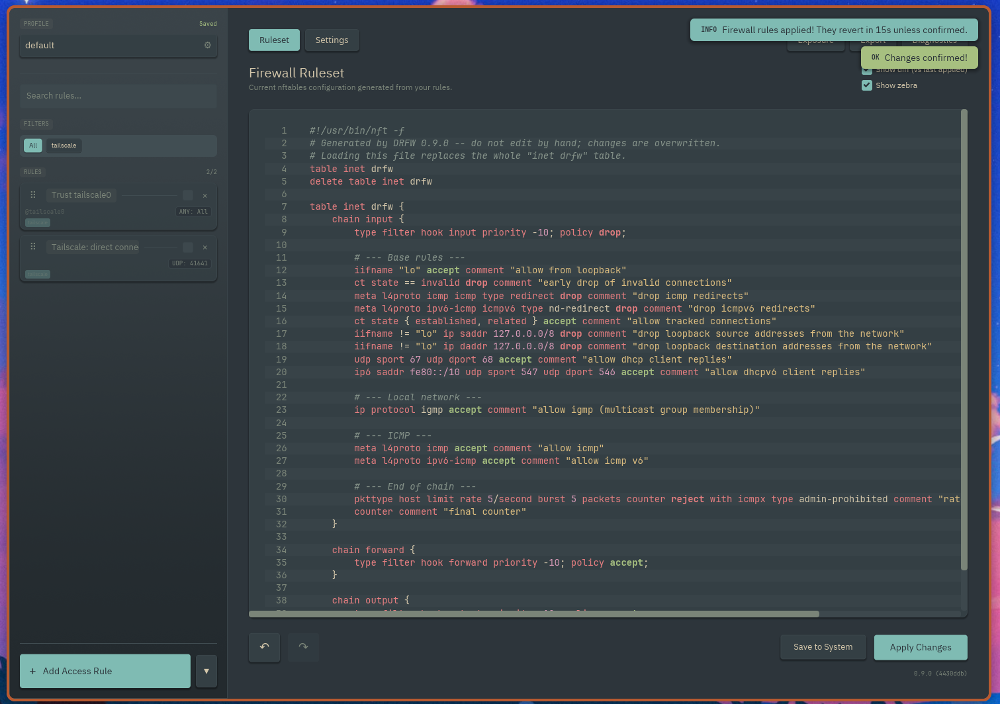
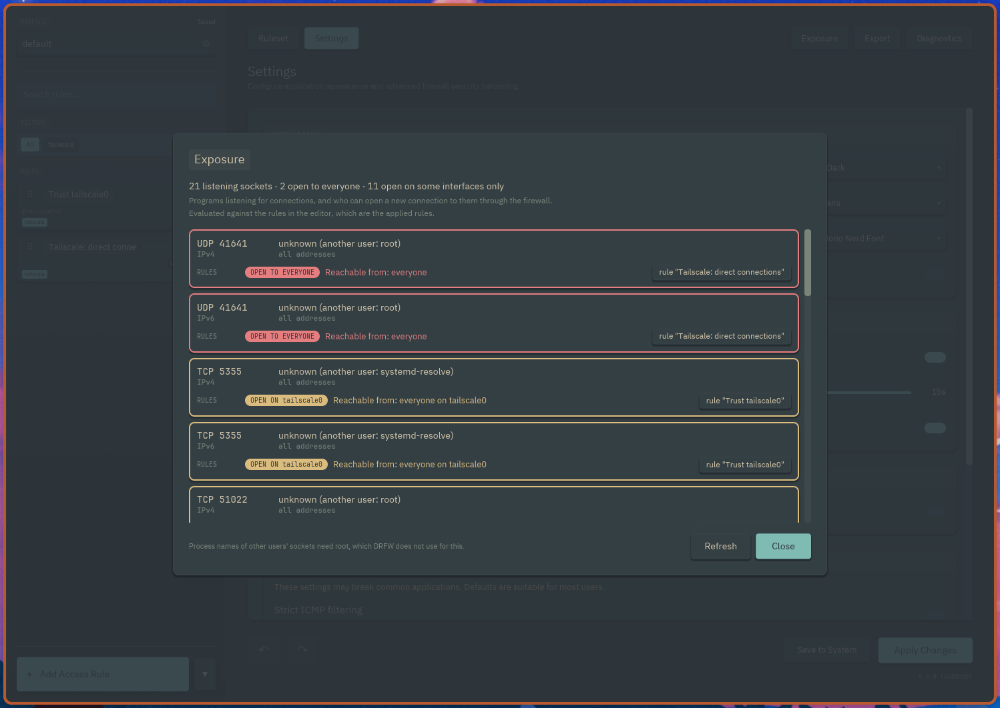
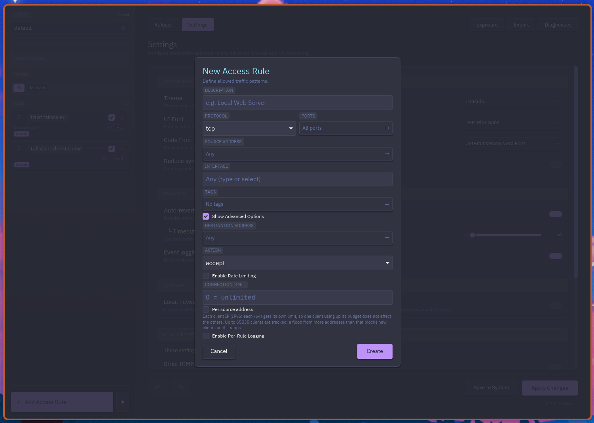
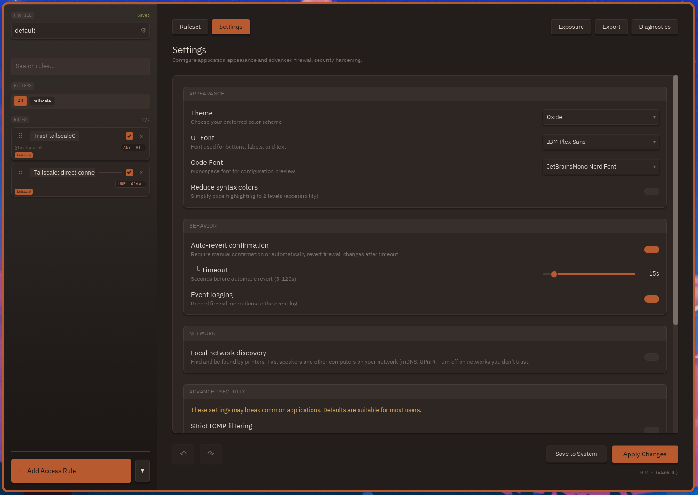
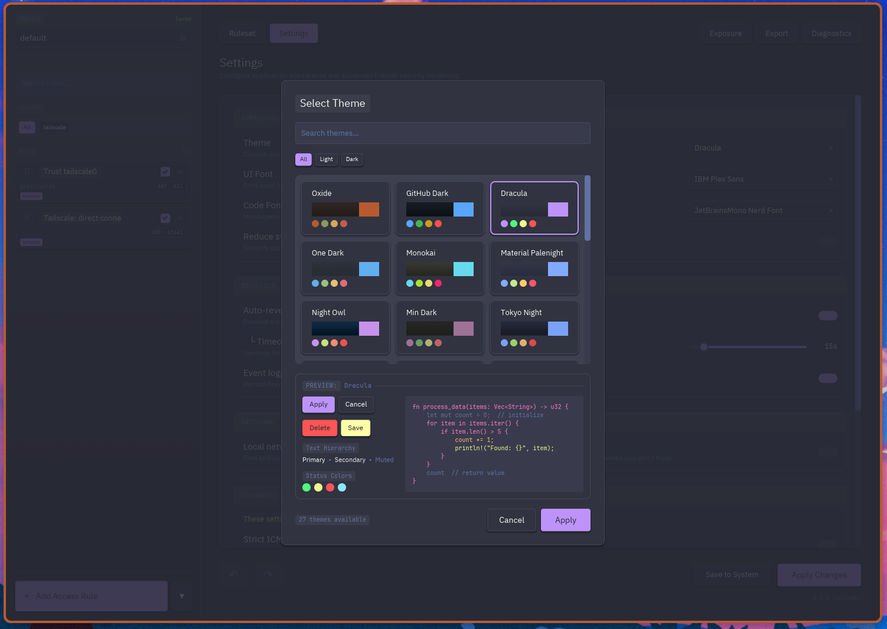

# DRFW — Dumb Rust Firewall

A safe, transparent nftables firewall for Linux, with a GUI and CLI.

<p align="center">
  <a href="https://github.com/ledati16/drfw/actions/workflows/ci.yml"></a>
  <a href="LICENSE"></a>
  <a href="https://www.rust-lang.org/"></a>
  <a href="https://github.com/iced-rs/iced"></a>
  <a href="#built-with-llms"></a>
</p>

> **Status: feature complete.** DRFW does what it set out to do. It may get maintenance
> and updates as needed (dependency and toolchain updates, fixes, compatibility with new
> nftables, kernel or GUI-toolkit releases), but no new features are planned.

<p align="center">
  
</p>

## What it is

DRFW manages the firewall of **one Linux computer** — a desktop, laptop or server —
through nftables, directly. You write simple rules ("allow TCP 22 from 192.168.1.0/24"),
DRFW shows you the **exact nftables ruleset** they produce, and applies it with a safety
net that rolls back automatically if you lock yourself out.

It follows the "dumb firewall" idea: explicit rules, sane defaults, no zones, no magic.
It does not do NAT, port forwarding, per-application filtering or multi-host management.

What sets it apart:

- **What you see is what runs, and what boots.** The preview, the rules applied to the
  kernel and the boot config file are generated from one source, and the tests prove
  they are identical by loading both into a real kernel.
- **It can't lock you out.** After every apply, a root-side timer reverts the change
  unless you confirm it — even if your SSH session drops, the terminal closes or DRFW
  crashes. Before applying, DRFW also warns when the new rules would stop your current
  SSH client from reconnecting, or when a change removes most of your rules.
- **It tells you the truth.** The Exposure view lists every program listening for
  connections and who can actually reach it through your rules. Errors from nftables
  point to the rule that caused them.
- **It stays in its lane.** DRFW only ever touches its own `inet drfw` table — Docker,
  libvirt, Tailscale and other tools keep their rules. This is enforced at the root
  boundary, not just by convention.

## Screenshots

<table>
  <tr>
    <td></td>
    <td></td>
  </tr>
  <tr>
    <td></td>
    <td></td>
  </tr>
</table>

## Features

**Rules**
- Protocols: TCP, UDP, TCP+UDP, ICMP, ICMPv6, both ICMPs, or any
- Ports: single, range or list (`22, 80, 443, 8000-8080`)
- Source and destination addresses (IPv4 and IPv6, CIDR, several per rule)
- Interfaces, with wildcards (`docker*`); incoming, outgoing (Server Mode) and forwarded rules
- Accept, drop or reject (with the reject type), per-rule logging
- Rate limits with burst and connection limits — optionally **per source address**
  (each client IP gets its own budget, so one client can't use up everyone's)
- Tags, search, drag-and-drop ordering, enable/disable, undo/redo
- **Templates** for what this computer has: VM guests on a libvirt bridge, Tailscale
- Every rule is validated; invalid rules are flagged and never applied

**Safety**
- Verification with `nft --check` before anything changes (without a password where possible)
- Auto-revert after every apply unless confirmed (5–120 s, on by default)
- SSH lockout check and a "big change" guard before Apply and Save to System
- One password prompt, remembered for about 5 minutes (polkit), for a small root helper
  that can only do DRFW's own jobs
- Profiles and settings are never silently overwritten; damaged files are kept aside

**Visibility**
- Syntax-highlighted preview of the generated ruleset, and a diff against what's applied
- Exposure view (and `drfw exposure`) — who can reach each listening port
- Readable nftables errors mapped to your rules
- Event log of every firewall operation

**Comfort**
- 27 colour themes, your own UI and code fonts, a reduced-colour mode
- Full keyboard control (F1 lists the shortcuts)
- A complete CLI for servers and scripts

## Default protection

DRFW is a stateful firewall. These rules are always there, checked in this order:

| Rule | Why |
|---|---|
| Allow loopback | Local services work |
| Drop invalid packets | Malformed and out-of-state traffic stops early |
| Drop ICMP redirects | Nobody on the network can re-route your connections |
| Allow established/related | Replies to your own connections get back in |
| Drop loopback addresses from the network | `127.0.0.0/8` only belongs on `lo` |
| Allow DHCP / DHCPv6 replies | Your address keeps renewing |
| **Your rules** | In the order you give them |
| Allow IGMP | Multicast (IPTV, UPnP) keeps working on managed switches |
| Allow ICMP | Ping and network diagnostics work |
| Everything else | Refused: a rate-limited "administratively prohibited" reply, then dropped |

Outgoing and forwarded traffic are allowed by default, so normal desktop use, Docker,
VMs and VPNs keep working. Settings let you tighten that:

| Setting | What it does |
|---|---|
| **Local network discovery** | Lets printers, TVs and other devices find this computer and vice versa (mDNS, UPnP). On for new profiles; turn it off on networks you don't trust |
| **Server Mode** | Blocks outgoing connections unless a rule allows them. Offers DNS, time sync, updates and ping as ready rules when you turn it on |
| **Block forwarded traffic** | Routed traffic (Docker, VMs, VPN gateways) needs explicit Forwarded rules |
| **Strict ICMP** | Only the ICMP types networks need |
| **ICMP rate limiting** | Caps incoming pings per second |
| **Anti-spoofing (RPF)** | Drops new connections whose source address couldn't have arrived on that interface |
| **Log dropped packets** | Rate-limited logging of what the firewall refuses |

When IP forwarding is on, DRFW tells you that forwarded traffic isn't filtered, and the
Exposure view marks ports published by Docker (which bypass input rules) instead of
calling them closed.

## Installation

**You need:** Linux with nftables (`nft`), and for the GUI a polkit authentication agent
(every desktop runs one). `sudo` or `run0` work in a terminal. systemd is optional.
DRFW is used daily on Arch Linux; its test suite also runs against the real `nft` on
Ubuntu in CI. `drfw check <profile>` tells you whether your kernel supports a profile.

**Arch Linux** — a PKGBUILD that builds the current source is in
[contrib/](contrib/README.md):

```bash
git clone https://github.com/ledati16/drfw.git
cd drfw/contrib && makepkg -si
```

It installs `drfw`, its root helper and polkit action, a desktop entry, icons and an
optional `drfw.service`.

**From source** (Rust is installed via [rustup](https://rustup.rs); the right toolchain
is picked automatically):

```bash
git clone https://github.com/ledati16/drfw.git
cd drfw && cargo build --release
./target/release/drfw
```

A source build has no installed root helper, so it asks for your password on every
apply. Packagers: see [contrib/README.md](contrib/README.md) for the root helper, the
polkit action, the systemd unit and the per-distribution build settings (Debian,
Fedora, openSUSE, NixOS).

## Using it

1. Run `drfw` as your normal user (not with `sudo` — it asks for elevation itself).
2. **Add Access Rule**, or pick a template from the ▾ next to it.
3. Check the preview, then **Apply Changes** — you're asked for your password once.
4. **Confirm & Stay** (or Ctrl+Enter) within the countdown. If you don't — because you
   can't reach the machine any more, say — the rules roll back on their own.
5. **Save to System** to load the rules at boot. It checks the exact file with
   `nft -c` first, keeps a backup of the previous one (and your original config, once),
   and can enable the boot service in the same step.

### Command line

```bash
drfw list                        # profiles
drfw status                      # active profile, rules, pending revert, boot config, SSH sessions
drfw check <profile>             # validate and nft --check, without a password; changes nothing
drfw apply <profile>             # apply with a 15 s auto-revert (--confirm 5-120 to change it)
drfw apply <profile> --no-confirm   # apply without auto-revert
drfw save <profile>              # save as the boot config (--enable-at-boot to enable the service)
drfw export <profile> --format nft|json
drfw exposure [profile] [--json] # who can reach the listening ports
```

During the countdown, `c` or Enter keeps the rules; `r`, Esc or Ctrl-C reverts them.
Scripts without a terminal need `--yes` where DRFW would otherwise ask (a big change,
an SSH lockout risk, saving untested rules). Exit codes, including the ones that mean
"look at your firewall now", are listed in `drfw --help`.

A safe sequence on a remote server: `drfw apply web`, confirm, `drfw save web`.

### Working with VPNs and containers

DRFW's table runs before other tools' tables (priority −10), and a drop there is final.
So with DRFW active, allow what you need explicitly: for Tailscale, use the templates
"Trust tailscale0" and "Tailscale: direct connections" (UDP 41641); for WireGuard, allow
its listen port; for libvirt VMs, the "VM guests" template. Anti-spoofing keeps working
with split- and full-tunnel VPNs.

## Recovery

- **During the countdown:** click **Rollback**, or just wait.
- **Remove DRFW's rules** (other tables stay): `sudo nft delete table inet drfw`
- **Restore the boot config:** `/etc/nftables.conf.drfw-bak` is the previous save,
  `/etc/nftables.conf.drfw-orig` is the config from before DRFW ever saved.
- **History:** the Diagnostics view, or `~/.local/state/drfw/audit.log`.

Profiles and settings live in `~/.local/share/drfw/`, logs and the record of the last
kept rules in `~/.local/state/drfw/` (all private to you).

## How it keeps you safe

- **Applying** runs one fixed script as root (through `drfw-helper`, the only program
  DRFW elevates). It saves the current DRFW table, starts a watcher, then applies. The
  watcher restores the saved table on timeout, on request, or if it is stopped — with
  no password and regardless of what happens to DRFW or your session.
- **The root helper** accepts only three requests (apply, save the boot config, check a
  ruleset), with every path fixed at build time, nothing taken from your environment,
  and only rulesets for DRFW's own table — no `flush ruleset`, no other tables, no
  file includes. That's why it is safe for polkit to remember your password for it.
- **Saving** writes the exact bytes the preview shows, after `nft -c` accepts them, and
  replaces the boot config atomically.
- **Testing:** hundreds of tests, many of them loading generated rulesets into a real
  kernel inside private network namespaces (no root needed): JSON vs text equivalence,
  the revert guard under signals, VPN routing, discovery, a forged ICMP redirect,
  ping floods. An end-to-end kit for real root and reboots is in
  [tools/e2e](tools/e2e/README.md), for a throwaway VM or container.

## Built with LLMs

DRFW was written entirely with LLMs (mainly Claude models), directed by someone without
a Rust background. It has had several independent automated audits and an extensive
test suite, but **no review by a human security expert**. Read the
[CHANGELOG](CHANGELOG.md), try a profile with `drfw check` and an auto-reverting apply
before you rely on it, and report anything that looks wrong.

Development standards are in [CLAUDE.md](CLAUDE.md). Reviews are welcome in
[Discussions](https://github.com/ledati16/drfw/discussions); if you want to take the
project further, fork and rename it (a link back is appreciated).

## License

MIT — see [LICENSE](LICENSE).

Built on [nftables](https://netfilter.org/projects/nftables/) and
[iced](https://github.com/iced-rs/iced); inspired by ufw's simplicity and firewalld's
safety features.
